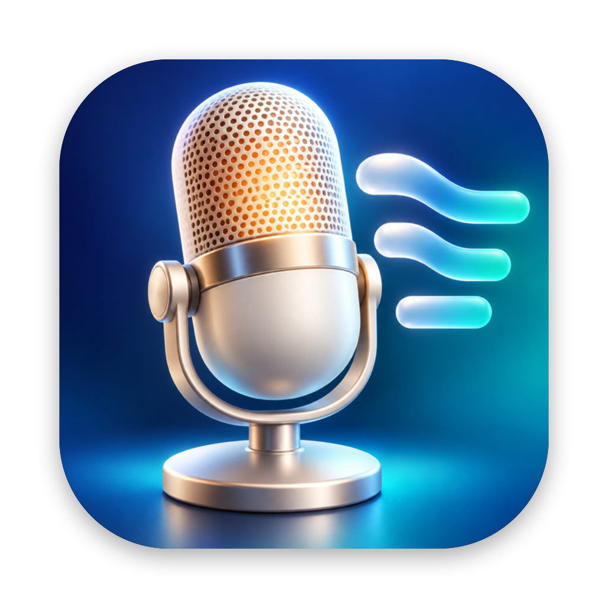

# Hear Me

**On-device voice typing for macOS.** Hold a key, speak, let go — the cleaned-up text is pasted into whatever app you are using. Speech recognition runs on Apple's on-device `SpeechAnalyzer`; the clean-up (filler words, self-corrections, punctuation, lists, tone per app, translation) runs on Apple's on-device Foundation Model. Nothing is sent anywhere. Inspired by [Typeless](https://www.typeless.com/).

Built for people who mostly speak Mandarin (Taiwan) with English technical terms mixed in, but works for English and Japanese too.



*App icon generated with Codex image generation, masked to the macOS icon shape; see `assets/ai/manifest.json`.*

---

## 這是什麼

macOS 選單列的語音輸入工具。按住 fn（或右 ⌥、右 ⌘）說話、放開，整理好的文字就貼進你正在用的 app，剪貼簿會還原。全程在這台電腦上完成：

- **辨識**：Apple `SpeechAnalyzer`／`SpeechTranscriber`（macOS 26 起內建，繁體中文、英文、日文…）。
- **整理**：Apple `FoundationModels` 裝置端模型（需要打開 Apple Intelligence）。沒開的話退回規則清理，仍然可用。
- **不連網、沒有雲端 API、沒有帳號、沒有訂閱。** 記錄檔只存在本機。

### 功能

| | |
|---|---|
| 按住說、放開貼 | 快速點一下＝一直聽到下一次點 |
| 去填充詞、去重複、改口只留最後 | 「三點，不對，四點」→「四點」 |
| 補標點、明確列舉才條列 | 「有三件事，第一…」→ 編號清單 |
| 每個 app 不同語氣 | 郵件正式、通訊軟體口語、終端機與編輯器照打；可自訂 bundle id |
| 個人字典 | 餵給辨識器當偏好詞，也告訴整理模型 |
| 更正記憶 | 圈選辨識錯的、打正確的，之後自動替換；或在原 app 改對後選起來「從選取文字學習」 |
| 晶晶體 | 中文夾英文技術詞：內建開發用語表模糊修拼字（realeasenotes → release notes、icone → icon），中英之間自動加空格 |
| 兩種語言自動偵測 | 主語言＋第二語言兩個模型同時聽，整句英文不會被中文模型拼成亂碼 |
| 翻譯 | 輸出語言可選英文、日文、台灣正體中文 |
| 對選取文字下語音指令 | 按住 ⇧＋快捷鍵說「翻成英文」「縮短成一句」「換正式一點」 |

## 需求

- macOS 26 以上、Apple Silicon。
- 整理功能需要「系統設定 → Apple Intelligence 與 Siri」打開（會下載幾 GB 的模型）。
- 權限：輔助使用（快捷鍵與貼上）、麥克風。

## 安裝

1. 到 [Releases](https://github.com/river0825/hear-me/releases) 下載 `HearMe.zip`，解壓後把 `HearMe.app` 放進「應用程式」。
2. 第一次打開：這個 app 沒有 Dock 圖示也沒有主視窗，只會在選單列出現一個麥克風圖示。系統會要「輔助使用」權限（之後第一次聽寫時要麥克風）。
3. 用 fn 鍵的話，到「系統設定 → 鍵盤 → 按下 🌐 鍵時」改成「不做任何動作」，否則系統自己的聽寫會跟著跳出來；或在設定裡改成右 ⌥。
4. 若系統說無法打開（未驗證的開發者）：`xattr -cr /Applications/HearMe.app` 後再開。app 用自簽憑證簽，不是 Apple 公證過的。

## 使用

- **聽寫**：游標放在要輸入的地方，按住 fn 說，放開。畫面下方的小浮窗顯示即時文字與狀態。
- **持續聽**：快速點一下 fn，講長一點，再點一下結束。
- **指令模式**：先選一段文字，按住 ⇧＋fn 說要做什麼，結果取代選取的文字。
- **更正**：選單列 → 「更正上一次聽寫…」，圈選錯的、打對的、按記住。
- **設定**：選單列 → 「設定…」：快捷鍵、辨識語言、第二語言、語氣、輸出語言、個人字典、每個 app 的語氣。
- 出問題時：選單列 → 「檢查權限…」與「顯示 log 檔」（`~/Library/Logs/HearMe.log`）。

## 從原始碼建置

純 SwiftPM，不需要 Xcode 專案；需要 Xcode 26 以上。

```sh
swift build
swift test                # 單元測試
./scripts/bundle.sh       # 產出 build/HearMe.app
open build/HearMe.app
```

沒有麥克風的機器可以用音檔走完整 pipeline：

```sh
./scripts/make-test-audio.sh                                   # 用系統 TTS 產測試音檔
.build/debug/HearMe --transcribe docs/evidence/zh-list.wav --polish
.build/debug/HearMe --simulate-live docs/evidence/zh-list.wav --locale zh_TW --locale2 en_US --polish
.build/debug/HearMe --doctor
```

CI 在 GitHub Actions（`macos-26`）跑 build 與測試；打 `v*` tag 會自動出 Release。細節與所有驗證證據在 [`docs/STATUS.md`](docs/STATUS.md)。

## 隱私

語音在本機辨識、本機整理，不上傳。記錄檔 `~/Library/Application Support/HearMe/history.jsonl`、更正記憶 `corrections.json` 都只在你的電腦上，隨時可以刪。

## 已知限制

- 只有 macOS；Windows、iOS 沒有計畫。
- 辨識語言一次兩種，不是自動偵測一百種。
- 整理模型是 Apple 的裝置端小模型：改口「不對」處理得好，「不是」這種語意含糊的會保留原句；翻譯會把專有名詞直譯。
- 自簽憑證：每次更新後 macOS 可能要你重新允許一次輔助使用。
